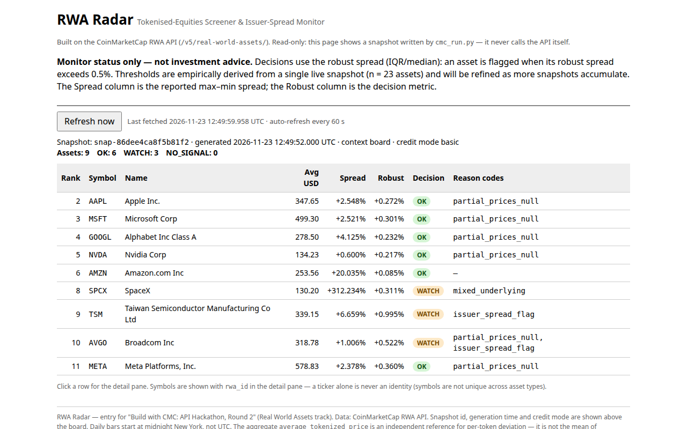

# RWA Radar — Tokenised-Equities Screener & Issuer-Spread Monitor

> One stock, many issuers, different prices. RWA Radar covers a universe
> of 4,812 tokenised equities on the CoinMarketCap RWA API and flags when
> the same stock costs different amounts depending on who issued the token.

[](https://www.python.org/)
[](https://docs.python.org/3/library/)
[](https://coinmarketcap.com/api/real-world-assets-api/)

**Status: feature-complete (recalibrated 23 Nov 2026).** Built 23 Nov 2026
in one day — repo cleaned of the Base prototype, adapter + pipeline + gate,
CLI (board/monitor/asset), dashboard, demo run, edge cases, measured credit
budget, evidence manifest. Review (DeepSeek) done 23 Nov 2026: READY AFTER
FIXES (71/100) — the same day the recalibration + fix round landed:
spread decisions now use a robust (IQR/median) metric with a single
binary flag (robust spread > 0.5%, empirically derived from one live
snapshot, n = 23), so the board actually discriminates (top-25: 15 OK,
8 WATCH). A follow-up round the same evening collapsed the two-level
threshold into that one flag and added a per-issuer deviation breakdown
next to every flagged asset.
Gate `gate_cmc.py` **10/10 PASS** (23 Nov 2026, live). Final video +
`SUBMISSION.md` done: `demo/video-final.mp4` — 2:40 (160.00 s), 1280×800,
H.264, silent; X cut `demo/video-final-x.mp4` — 2:18 (137.63 s), under the
140 s X limit. Next: final review + submission target **5 Dec 2026** (hard
deadline 9 Dec 23:59 UTC). Built for the **Build with CMC: API Hackathon,
Round 2 — Real World Assets track**. Read-only: no trading, no wallet, no
private keys.

## What it does

- **Ranked board** — the top-N of a universe of 4,812 tokenised stocks
  ordered by `rwa_rank` (default 100, demo run used top-25), with
  tokenised price, market cap and 24h volume from `assets/list`.
- **Issuer-spread monitor** — for one stock, the price of its token on each
  issuer (Backed, Ondo, Dinari, …) from `quotes/latest`'s `tokens[]`; the
  spread (max − min across priced tokens) is the signal. Same deviation
  know-how as our Exit Radar, with the issuer — not a DEX pool — as the
  comparison base.
- **Sparkline + % change** — computed from `quotes/historical` (daily, 30
  points), because the list/quotes responses carry no percent-change fields.
  Verdicts are honest monitor states — `OK` / `WATCH` / `NO_SIGNAL` — never
  investment advice.

## Live evidence

Real API calls, captured **23 Nov 2026 13:06 WITA / 05:06 UTC** by
`capture_cmc_evidence.py` (raw envelopes + SHA-256 manifest in
[`evidence/cmc/manifest.json`](evidence/cmc/manifest.json)):

| Check | Result |
|---|---|
| `map` NVDA | `rwa_id` 2, `rwa_rank` 5, `has_tokens` true — **0 credits** |
| `assets/list` (stock, top 5) | **4,812** tokenised stocks; AAPL (r2), MSFT (r3), GOOGL (r4), NVDA (r5), AMZN (r6) — **1 credit** |
| `quotes/latest` NVDA | avg tokenised price 134.37; `tokens[]` = **9 tokens, 8 priced, Dinari (`NVDA.D`) null** — **1 credit** |
| Issuer spread (NVDA) | **0.652%** at capture (max 134.634 WNVDAX / min 133.757 rNVDA (Reality)) — above the old experimental 0.5% line on the reported spread (that line applied to the reported spread at the time; the v0.3.0 method flags on the robust spread instead — NVDA's robust spread at capture is ~0.15%, so it is not flagged — see "How the spread is measured") |
| `quotes/historical` NVDA | 30 daily closes — **1 credit** |
| `info` NVDA | company fields — **1 credit** |
| `issuers/list` | roster — **1 credit** |
| **Total for the capture** | **5 credits** |

Notes on the numbers: the spread moves with the market (0.576% at 12:44 →
0.707% at 12:47 → 0.652% at 13:06 WITA the same day), so every figure is
timestamped and the gate checks the pipeline against a stored fixture,
never against a live number. `average_tokenized_price` (134.37) is **not**
the plain mean of `tokens[]` — the spread is therefore computed from
`tokens[]` only, with the aggregate used as an independent reference.
A first design draft quoted a 0.086% spread; that came from a truncated
(`head -c 1500`) response showing only 4 of the 9 tokens. The corrected
fixture is recorded in `DESIGN-CMC-RWA.md` §3.3.

## How the spread is measured (v0.3.0)

Two numbers, two jobs — the **reported** spread is honest, the **decision**
spread is robust:

- **Reported spread (`spread_pct`)** — max − min across priced tokens,
  divided by `average_tokenized_price` (the API's aggregate, used as the
  denominator because it is an independent reference, not the mean of
  `tokens[]`). This number is never trimmed: a 311% SPCX spread stays
  311% on the board, with the outlier tokens listed next to it.
- **Decision metric (`robust_spread_pct`)** — (Q3 − Q1) / median × 100
  over the priced tokens (inclusive quartiles). One stray token cannot
  move it: AMZN's reported spread is 20.4% but its robust spread is
  0.087%, because eight of its nine tokens sit in a tight cluster.
- **Threshold — one binary flag, empirically derived** (from the live
  top-25 board, 23 Nov 2026 20:23 WITA; robust spreads across 23 covered
  assets: median 0.265%, p75 0.440%, p90 0.597%): an asset is **flagged
  when its robust spread exceeds 0.5%** (≈ p85 of that board). There is
  no second level — a sample of n = 23 assets from a single snapshot
  cannot defend two cut points. Thresholds are empirically derived from
  a single live snapshot (n = 23 assets) and will be refined as more
  snapshots accumulate. On a fresh board run the same evening (20:48
  WITA) the flag reads **15 OK, 8 WATCH** (SPCX mixed underlying; TSM,
  WMT, JPM, V, JNJ, XOM, ASML flagged on robust spread), where the old
  method flagged 22/23 WATCH and meant almost nothing.
- **Per-issuer breakdown.** Next to every flagged asset — in the CLI
  board output and in the dashboard detail pane — each issuer's price
  is shown with its deviation from the asset's **median** priced token,
  largest deviation first, so a reader can see at a glance which quote
  drives the flag (e.g. SPCX: SPACEX PreStocks +308% from the median
  while the other ten tokens sit within ±3%).
- **`mixed_underlying`** — a priced token more than **100%** from the
  median priced token (SPCX's ~$512/$531 tokens against a ~$131 median).
  The line is 100%, not 50%: TSLA already sits 43.8% from its median and
  a 51% outlier is one stray token, not a second instrument — it is
  shown in the tokens table, not hidden.
- **Informational codes never decide.** `partial_prices_null` (a token
  with no price) and `history_short` (fewer than 7 closes) are listed in
  `reason_codes` and shown in the UI, but alone they mean OK. Blocking
  codes (`no_tokens`, `all_prices_null`, `thin_issuer_count`,
  `empty_tokens`) still mean `NO_SIGNAL`.

## How to run

Python 3.10+, standard library only — no `pip install`, no build step.

```bash
# 1. Put your CMC Pro API key in .env.local (see .env.local.example).
#    The key is read at runtime and never printed, logged or committed.
CMC_API_KEY=

# 2. Board (top-25 by rwa_rank) -> out/cmc_snapshot.json
python3 cmc_run.py board
python3 cmc_run.py board --limit 100

# 3. Monitor the watchlist (top-20 + optional ticker), 3 cycles
python3 cmc_run.py monitor --cycles 3
python3 cmc_run.py monitor --ticker AAPL

# 4. One asset in detail: info + tokens[] + spread + % change + sparkline
python3 cmc_run.py asset NVDA
python3 cmc_run.py asset 9        # SPCX by rwa_id

# 5. Dashboard (local only, serves the latest snapshot)
python3 serve.py                  # http://127.0.0.1:8000/

# 6. Capture raw API evidence (5 credits) + SHA-256 manifest
python3 capture_cmc_evidence.py   # -> evidence/cmc/manifest.json

# 7. Gate (10 items; live items cost ~38 credits per full run)
python3 gate_cmc.py
```

## Endpoints used

| Endpoint | Used for | Credits |
|---|---|---|
| `map` | Resolve tickers → `rwa_id` | 0 |
| `assets/list` | Screener board (`asset_type=stock`, `sort=rwa_rank`) | 1 / 250 assets |
| `quotes/latest` | Monitor refresh — aggregates + `tokens[]` + `tradfi_markets[]` | 1 / 250 assets |
| `quotes/historical` | Sparkline + % change (`interval=daily`, `count=30`) | 1 / 100 points |
| `info` | Detail pane (company fields, About, logo, website) | 1 / 250 assets |
| `issuers/list` + `issuers` | Issuer roster + tokens per issuer | 1 / request |

**`market-pairs/list` is NOT used** — it is Growth+ only and is unavailable
on the hackathon's free Startup tier. The entry is built entirely on the
seven endpoints above.

## What the CMC API made possible — and where it got in the way

The RWA endpoints made this entry possible in a day: one `assets/list`
call returns the whole 4,812-stock universe with ranks, and `tokens[]`
inside `quotes/latest` exposes per-issuer prices that no other public API
we found publishes — the entire issuer-spread idea is just reading that
array honestly. Where it got in the way: `quotes/historical` is new
(18 Nov 2026) and returns no percent-change fields, so % change and
sparklines are computed client-side; `assets/list` returns rows with
`rwa_id: null` that cannot be quoted by id; and `market-pairs/list` —
the natural source for issuer-level liquidity — sits behind the Growth+
tier the hackathon grant does not include, so depth per issuer is out of
scope.

## Credit budget — measured live, not assumed

Per-call costs measured by `gate_cmc.py` item 6 (23 Nov 2026, live):
`assets/list` top-100 = **1** credit; `quotes/latest` 20 ids = **1**;
`quotes/historical` 20 ids × 30 points = **6** (600 points / 100);
10 ids × 30 = **3**. Projected from those measured numbers and the
configured Startup cadence (board 5 min, quotes 60 s, historical 15 min):

| Work (Startup tier, 450,000 credits/mo) | Per hour | Per month |
|---|---|---|
| Board top-100 every 5 min | 12 | 8,640 |
| Watchlist quotes every 60 s (≤250 assets) | 60 | 43,200 |
| Historical, 20 assets × 30 points every 15 min | 24 | 17,280 |
| `info` / `issuers` on demand | — | ~150 |
| **Total** | **96 (≤ 100)** | **~69,270 (~15.4% of 450,000)** — 96/hr scheduled + ~150/month on demand |

Fallback if the free Startup upgrade has not landed on the dashboard yet:
slow cadence ≈ **6,840/month**, under the Basic allowance. Switch with the
`CREDIT_MODE = "startup" | "basic"` flag in `cmc_config.py`, never by
editing code. (Dashboard showed 10,000 credits/mo, billing showed 15,000 —
the fallback is sized against the conservative 10,000 figure.)

## Screenshots

Real captures from the demo run (`demo/run_demo.sh`, 23 Nov 2026 — live
CLI output and the local dashboard, no mock data):



*Board — top-10 stocks by `rwa_rank`, spread and decision per asset.*


*Detail pane — NVDA: price per issuer, spread, % change and sparkline.*


*Detail pane — an asset with no tokens: an honest `NO_SIGNAL`, no invented
numbers. Terminal captures of the CLI (shots 1–2) and the evidence
manifest (shot 4) are in `demo/shots/`.*

## What's new vs pre-existing

This entry is written fresh for this hackathon. The starting point was a
clone of our Exit Radar prototype for Base tokenised stocks (v0.3.3) — but
**every Base file was deleted from this repo** (code, docs, evidence,
fixtures, outputs; see `DESIGN-CMC-RWA.md` §4.2). Zero lines of Base code
were copied. What carries over is only **method know-how, expressed as
design**: the deviation method (compare independent prices of the same asset
and report the spread), reason codes instead of a 0–100 composite score,
offline gates from fixtures, canonical snapshots + hash, stdlib-only and
fail-closed discipline. All CMC code (`cmc_adapter.py`, `cmc_pipeline.py`,
`cmc_run.py`, `serve.py`, `dashboard/index.html`, `gate_cmc.py`,
`capture_cmc_evidence.py`, `cmc_config.py`) is written from scratch on the
CMC RWA research in `CMC-RWA-ENDPOINTS.md`. See `CMC_INTEGRATION.md` for
the full statement. This satisfies the hackathon rule: *pre-existing
projects are eligible only if the CMC integration is new and clearly
identified.*

## Submission links

- Hackathon: [Build with CMC: API Hackathon (Plushie), Round 2 — DoraHacks](https://dorahacks.io/hackathon/coinmarketcap-api-202611/detail)
- Demo video: [`demo/video-final.mp4`](demo/video-final.mp4) — 2:40
  (160.00 s), 1280×800, H.264, silent, 23.7 MB. Re-cut from the live
  demo run (23 Nov 2026 20:49–20:50 WITA) by `demo/build_final_video.sh` for
  the v0.3.0 follow-up round — see `SUBMISSION.md` for sources and
  verification.
- Post on X (#BuildwithCMC): draft in [`SUBMISSION.md`](SUBMISSION.md) —
  post with the submission (needs Septian's ACC). The full video is
  2:40 and X free accounts cap video uploads at 2:20 — post the X cut
  `demo/video-final-x.mp4` (2:18, 137.67 s), not the full video.
- Track: **Real World Assets** (one track per submission)
- Deadline: **9 Dec 2026 23:59 UTC** (10 Dec 08:00 WITA); our target: 5 Dec

## Limitations (honest)

- **Spread threshold: one binary flag, empirically derived.**
  `ROBUST_SPREAD_FLAG_PCT = 0.5%` comes from the live board's
  robust-spread distribution (23 Nov 2026, top-25: median 0.265%, p75
  0.440%, p90 0.597%). Thresholds are empirically derived from a single
  live snapshot (n = 23 assets) and will be refined as more snapshots
  accumulate — a sample that size cannot defend two cut points, so there
  is no second level. The flag applies to the robust (IQR/median)
  spread, not to the reported max–min spread — see "How the spread is
  measured".
- **The max–min spread is dominated by single-token outliers, so it no
  longer decides.** On a live board run (23 assets covered) the old
  method flagged 22/23 WATCH, almost always because of one token: AMZN
  20.6% and TSLA 43.8% (Hyperliquid token far from the cluster), MU 28%
  and SKHY 10% (Backed "w…" tokens). The robust spread decides instead;
  the max–min spread is still reported as-is and the outlier is visible
  in the tokens table.
- **Mixed underlying (SPCX).** `tokens[]` for SPCX mixes two different
  instruments: 10 tokens ~$131 plus SPACEX (PreStocks) ~$531 and tSpaceX
  (Tessera) ~$512 — spread 305%. The pipeline flags this with reason code
  `mixed_underlying` (any priced token >100% from the median priced token)
  and lists the outlier tokens with issuer name and price; the spread is
  NOT silently trimmed, so the 305% is shown and explained, not hidden.
- **`assets/list` returns rows with `rwa_id: null`.** In the live top-20,
  GOOG and a duplicate BRK.B row carry no `rwa_id` and cannot be quoted by
  id — the CLI drops them with an explicit stderr warning and counts only
  the covered assets (re-verified live by gate item 4, 23 Nov 2026).
- **The aggregate is not the mean of `tokens[]`.** Verified live: average
  tokenised price ≠ mean of priced tokens. The aggregate is an independent
  reference only; the spread uses `tokens[]` alone.
- **Daily bars for stocks/ETFs start at midnight New York time**, not UTC.
  Do not align them with UTC daily bars from other sources.
- **Sparkline only when historical data exists.** Board snapshots carry no
  historical closes, so the dashboard says so honestly instead of drawing
  a chart from missing data; run `cmc_run.py asset <symbol>` (or
  `monitor`, which refreshes historical every 15 min) for a snapshot with
  a sparkline.
- **Startup-tier upgrade pending.** As of 23 Nov the CMC dashboard still
  shows Basic; the slow-cadence fallback applies until the upgrade is
  confirmed.
- **Not investment advice.** Verdicts are monitor states (`OK` / `WATCH` /
  `NO_SIGNAL`) about price consistency across issuers and trend — nothing
  more.
